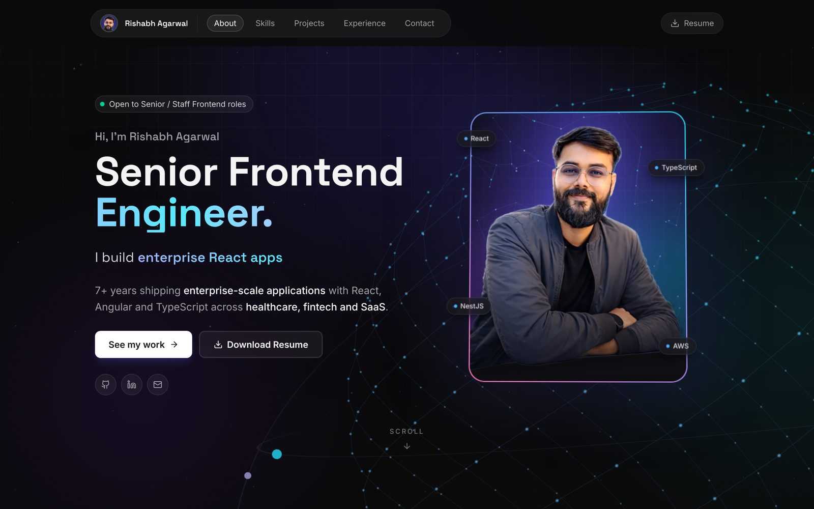
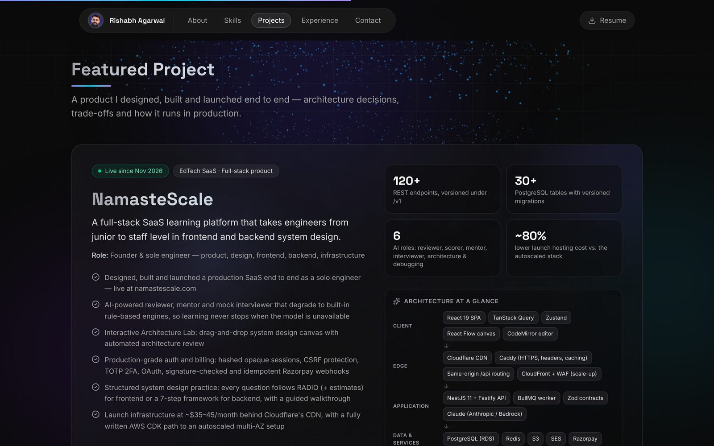

# Rishabh Agarwal — Portfolio

Personal portfolio of **Rishabh Agarwal**, Senior Frontend Engineer.
Live: **https://rishabh-agarwal.vercel.app**





## Stack

- React 19 + TypeScript (strict) + Vite 7
- Tailwind CSS v4
- Motion (animations, respects `prefers-reduced-motion`)
- three.js (interactive network-globe hero, lazy-loaded after first paint)
- React Router 7 (case-study pages are code-split)
- Self-hosted variable fonts (Inter, Space Grotesk) via Fontsource

## Getting started

```bash
npm install
npm run dev       # http://localhost:5173
npm run build     # type-check + production build into dist/
npm run preview   # serve the production build
npm run lint
```

## Project structure

```
src/
  data/data.ts            # ALL content: profile, skills, experience, case studies
  components/             # page sections (Hero, Skills, CaseStudies, Experience, …)
  components/CaseStudy.tsx  # /case-study/:id detail page
  components/ScrollManager.tsx  # scroll-to-top on navigation, #hash and cross-page section links
  hooks/                  # useScrollSpy, useSmoothScroll
public/                   # resume PDF, favicons, OG image, robots.txt, sitemap.xml
vercel.json               # SPA rewrites (deep links like /case-study/x) + caching/security headers
```

## Updating content

Everything text-based lives in `src/data/data.ts`:

- `profile` — name, title, email, socials, resume path, `openToWork` badge toggle
- `skills`, `experience`, `caseStudies`

When adding a case study, also add its URL to `public/sitemap.xml`.
To replace the resume, overwrite `public/Rishabh_Agarwal.pdf`.
